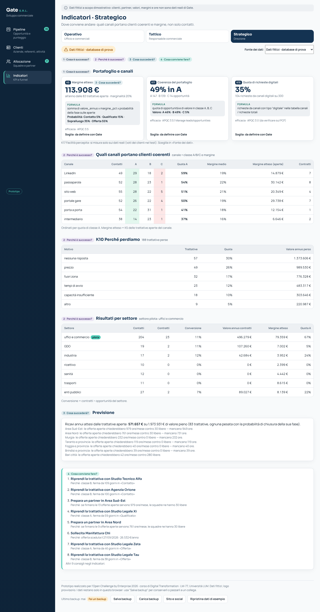

# Gate · Sviluppo commerciale (prototipo)

Prototipo web per **Gate S.R.L.**: porta in digitale il percorso commerciale "dai contatti ai contratti", dalla richiesta del cliente alla commessa affidata a chi la esegue. Ha un **database SQL** interrogabile con SQLite o MySQL. L'app e le query lavorano sugli **stessi dati**.

> **Dati fittizi.** Clienti, referenti, squadre, partner, valori, margini, ore e numeri di telefono sono inventati a scopo dimostrativo e non sono dati reali di Gate. Gli andamenti del database sono inseriti apposta per verificare il metodo (vedi `docs/dati-generati.md`). Il logo è provvisorio: verrà sostituito da quello ufficiale solo previo permesso di Gate.


## Il problema

Oggi Gate acquisisce commesse da portali di gara, con attività "porta a porta" e tramite intermediari. La sfida proposta da Gate: **come acquisire nuovi clienti e posizionarsi come partner nella gestione delle strutture**, partendo da un settore e un territorio pilota (ipotesi: uffici e studi professionali a Bari, nel database "uffici e commercio").

Gate ha chiesto tre risultati:
- un piano commerciale pilota;
- un percorso di vendita nel CRM;
- una dashboard delle opportunità "dai contatti ai contratti".

Il vincolo: acquisire solo clienti coerenti con la capacità operativa e la marginalità attesa.

**Regola di adozione:** al cliente non si chiedono app, account o password.
- La richiesta arriva dal modulo "Richiedi un sopralluogo" o da WhatsApp Business ed entra nel CRM con il canale di origine.
- L'offerta si firma da un link.
- La tecnologia nuova sta tutta dal lato di Gate.

## I componenti

| Componente | Cosa fa | Slide del deck (ipotesi da confermare) |
|---|---|---|
| **Database** (`data/gate.db`, `data/gate_mysql.sql`) | 13 tabelle: clienti, referenti, commerciali, opportunità con storico delle fasi, offerte, attività, costi dei canali. Poi i dizionari dei **canali** e dei **contenuti**, il **catalogo dei KPI** e le **richieste reali** importate. Si apre con DB Browser for SQLite o si carica in MySQL. | 26 (KPI di partenza), 27, 30 |
| **Catalogo dei KPI** (`kpi_catalogo`, `docs/kpi.md`) | 17 KPI con domanda di business, formula, livello della piramide di Anthony, tipo (efficacia, efficienza, adozione), processo APQC e soglia. È la fonte unica per SQL, app e Power BI. | 34-35 (TO-BE e KPI) |
| **Modulo "Richiedi un sopralluogo"** (`sopralluogo.html`) | Modulo breve, senza registrazione: azienda, settore, comune, tipo di ambienti, metri quadri, frequenza, referente, contatto e consenso privacy con informativa breve. Legge dal link `utm_source`, `utm_campaign` e `utm_content` e prepara il messaggio per WhatsApp o per email. | 40 |
| **Modulo "Richiedi un preventivo"** (`modulo.html`) | Secondo modulo, distinto (decisione del team), per chi conosce già servizio e ore. | 40 |
| **Pipeline** | Fasi Contatto → Qualificato → Sopralluogo → Offerta → Contratto (più Perso). Ogni opportunità ha il **punteggio di coerenza A/B/C**, con il contributo di ogni criterio. Alla creazione si calcola il **preventivo indicativo**: ore, prezzo annuo e margine, con un avviso se il margine è sotto il minimo. In fase Offerta c'è la **firma da link** (simulata). | 42 (preventivo e classe), 43 (pipeline e firma) |
| **Clienti** | Aziende e referenti, contatto con un clic (Chiama, WhatsApp, Email), cronologia, prossime azioni, privacy. La finestra **Sito e social** contiene: i link tracciati per canale, il **piano dei contenuti** con il link pronto per ogni contenuto e l'importazione delle richieste. | 40 |
| **Allocazione** | Ogni contratto va prima a una **squadra interna** con ore libere nella zona. Altrimenti si propone a un'**impresa partner** su WhatsApp, che risponde SÌ o NO (solo DURC regolare, niente lavoratori autonomi; il cliente resta di Gate). I partner sono "in roadmap" nel PASSAGGIO 3: il team ha scelto di tenerli. Si spengono con `funzioni.partner` in `js/config.js`. | 43 |
| **Indicatori** | Tre viste, una per livello decisionale. Ognuna dice da quale fonte legge: **Dati fittizi** oppure **Dati reali** (fotografia di partenza o test), e un selettore passa dall'una all'altra. | 44 (dashboard) |

Le tre viste degli Indicatori:
- **Operativo** (ufficio): richieste da gestire, trattative ferme K9, tempo di prima risposta K12, richieste registrate entro 24 ore K14.
- **Tattico** (responsabile commerciale):
  - funnel e KPI K1–K3 e K7;
  - conversione e costo per canale K4;
  - pipeline ponderata K6, durata del ciclo K8, tempo fino all'offerta K13, firme da link K16;
  - richieste qualificate per contenuto.
- **Strategico** (direzione): margine atteso K5, motivi di perdita K10, coerenza del portafoglio K11, quota digitale K15, facilità percepita K17. Poi la **matrice canale × classe A/B/C con il margine**, cioè quali canali portano clienti coerenti, non solo contatti.



<p>
  
  
  
  
</p>

## Il flusso della demo (meno di 90 secondi)

1. **Il cliente chiede un sopralluogo.** Apre `sopralluogo.html` dal link di un post LinkedIn (`?utm_source=linkedin&utm_campaign=uffici-e-commercio&utm_content=prova-03`) e invia la richiesta su WhatsApp.
2. **La richiesta entra nel CRM.** In Clienti → Sito e social si incolla il messaggio e si preme Importa. Nasce un'opportunità in **Contatto** con canale, campagna, contenuto, data di registrazione di oggi e consenso. Ha già il **preventivo** e la **classe A/B/C**.
3. **La trattativa avanza nella Pipeline:** È qualificato → Sopralluogo fatto → Offerta inviata → **Firma da link** (simulata) → Contratto.
4. **Allocazione e Indicatori.** In Allocazione la commessa va a una squadra o a un partner. Negli **Indicatori** (vista Tattico) K16 conta la firma da link e il contenuto compare tra le richieste qualificate.

## Le quattro domande dell'analisi

Ogni sezione dice a quale domanda risponde:
1. **Cosa è successo?** KPI e funnel.
2. **Perché è successo?** Motivi di perdita, canali, contenuti, settori e criteri del punteggio.
3. **Cosa succederà?** Pipeline ponderata, margine atteso, ore che serviranno alle squadre.
4. **Cosa conviene fare?** Consigli con il loro "perché": regole leggibili in `js/analisi.js`, con le soglie in `js/config.js`.

## Collegamento con la deliverable del corso

| Task della deliverable | Dove si trova nel progetto |
|---|---|
| Processi AS-IS e TO-BE (BPM, APQC) | **AS-IS:** i tempi di risposta e di registrazione oggi, misurati sulla **fotografia di partenza** (`richieste_reali`, fonte partenza). **TO-BE:** modulo, registrazione immediata, preventivo, firma da link e report; il test di tre settimane li misura (fonte test). |
| KPI (APQC e KPI compendium) | `kpi_catalogo` e `docs/kpi.md`: ogni KPI ha il processo APQC, categoria 3.0 Market and Sell (dove il PASSAGGIO lo indica, "da verificare sul PCF"). |
| Piramide di Anthony | Le tre viste degli Indicatori (operativo, tattico, strategico) e la colonna `livello_anthony` del catalogo. |
| Piattaforma e platform thinking | Cliente senza app (modulo e WhatsApp), partner via WhatsApp, CRM come punto unico dei dati, canali tracciati con utm senza pixel. |
| Roadmap della trasformazione | Le **evoluzioni previste:** portale partner (anteprima in Allocazione), lead scoring con modello statistico, archivio condiviso online. |
| Digital gap | La quota di richieste digitali (K15) e la registrazione delle richieste (K14), prima e dopo il test. |

## Interrogare il database con SQL

Il database è uno solo e si può usare in tre modi, dal più semplice:

1. **DB Browser for SQLite** (gratuito, nessuna installazione di server). Apri `data/gate.db` e scrivi le query nella scheda "Esegui SQL".
2. **MySQL o MariaDB.** Carica `data/gate_mysql.sql`, provato su MariaDB:
   - con **MySQL Workbench**: *File → Open SQL Script → esegui*;
   - da terminale: `mysql -u root -p < data/gate_mysql.sql`.

   Crea il database `gate` con tipi veri (DATE, DECIMAL), chiavi primarie ed esterne.
3. **Power BI o Excel.** Importa i CSV di `data/csv/`, uno per tabella.

**Differenze tra i dialetti:**
- I giorni tra due date si calcolano con `julianday(fine) - julianday(inizio)` in SQLite e con `DATEDIFF(fine, inizio)` in MySQL.
- I campi vuoti sono `NULL` in entrambi: si cercano con `IS NULL`, non con `= ''`.

## Rigenerare i dati e importare i dati veri

```
python3 generatore/genera_dati.py        # database, CSV, copia MySQL, js/dizionari.js, js/dati-db.js, docs/kpi.md
python3 generatore/controlla_dati.py     # controlli: deve finire con "tutti i controlli superati"
python3 generatore/importa_richieste.py data/esempi/richieste-partenza-esempio.csv
python3 generatore/importa_richieste.py data/esempi/richieste-test-esempio.csv --voti data/esempi/voti-test-esempio.csv
```

- **Parametri e dizionari.** Stanno in `generatore/parametri.py`: canali, settori, servizi, comuni, fasi, pesi del punteggio e ipotesi H1–H5. Con lo stesso seme i dati sono identici. L'app legge gli stessi dizionari da `js/dizionari.js`: si cambia un solo file e si rilancia il generatore.
- **Dati veri (fotografia di partenza e test).** Si scrivono in un CSV con le colonne del foglio condiviso: `data_richiesta, data_registrazione, canale, settore, data_risposta, data_offerta, esito, fonte`, più `note` se serve. Le date possono essere scritte `AAAA-MM-GG` o `GG/MM/AAAA`.
- **Controlli dell'import.** Controlla date, canali, settori ed esiti, stampa le righe scartate con il motivo e sostituisce le righe già importate con la stessa fonte. I voti di facilità arrivano da un secondo CSV facoltativo (`fonte, riga, voto_facilita`).
- **I CSV di esempio.** Quelli in `data/esempi/` sono **inventati**: servono a provare l'import prima dei dati veri, e l'app li segnala come esempio. Nel CSV del test c'è apposta una riga sbagliata.
- **Il database si rigenera senza perdere i dati veri.** `genera_dati.py` conserva la tabella `richieste_reali`. I dati reali non si mescolano mai con quelli fittizi.
- **Attenzione alla privacy.** Il prototipo pubblicato su GitHub Pages contiene `js/dati-db.js`. Con dati personali veri il prototipo **non va pubblicato**: si usa in locale, previa verifica GDPR con Gate.

## Ipotesi nei dati fittizi

| Ipotesi | Parametro | Sui dati generati |
|---|---|---|
| H1 il passaparola converte in contratto più di ogni altro canale | `PASSAGGIO_PER_CANALE` | passaparola 24,2%, il primo canale |
| H2 negli uffici LinkedIn converte meglio del porta a porta | `BOOST_LINKEDIN_UFFICI` | 25,0% contro 3,7% |
| H3 la classe A chiude più spesso della classe C | `EFFETTO_PUNTEGGIO` | A 16,8%, B 11,1%, C 0% |
| H4 l'intermediario ha il margine più basso | `MARGINE_PER_CANALE` | 15,5%, contro 18–22% degli altri canali |
| H5 i nuovi contatti crescono di mese in mese | `CRESCITA_CONTATTI` | da 2 a marzo a 72 a settembre (ottobre parziale) |
| H6 nella GDO il portale gare converte meno ma con margine più alto | **non inserita: test cieco** | il portale gare usa la media degli altri canali in tutti i settori |

Pipeline aperta: 83 opportunità aperte su 300 (96% contattate da agosto), chiusura 13,4% sulle chiuse, 12% delle aperte ferme.

## Come avviarlo

- **In locale:** apri `index.html` con un doppio clic, non serve installare nulla. Per condividerlo in un solo file: `python3 strumenti/versione_unica.py` crea `dist/gate-crm-prototipo.html`.
- **Online, con GitHub Pages:** *Settings → Pages → Deploy from a branch*, cartella `/ (root)`.
- **Dove stanno i dati.** I dati del CRM restano nel browser (localStorage). Il piè di pagina ha tre pulsanti:
  - **Salva backup**;
  - **Carica backup**;
  - **Ripristina dati di esempio**: riparte dal database di prova, con le date spostate in modo che il 19/10/2026 coincida con oggi.
- **Browser che avevano la versione precedente.** Un avviso propone di passare ai nuovi dati, senza cancellare quelli salvati.
- **Prove automatiche.** Si avviano con `NODE_PATH=$(npm root -g) node prove/e2e.js`, con il server locale `python3 -m http.server 8765 --bind 127.0.0.1` acceso. Coprono:
  - il flusso della demo;
  - l'app uguale al database;
  - le fonti reali;
  - i partner spenti;
  - la migrazione;
  - i contenuti.

  Tutto a 1440×900 e 390×844, con zero errori in console. `FOTO=1` rifà gli screenshot.

## Gate può usarlo davvero?

Per il pilota sì, da una persona alla volta: registra clienti, trattative e attività, con backup ogni sera.

**Limiti:**
- un browser, una copia dei dati;
- nessun login;
- promemoria solo dentro l'app;
- un servizio per opportunità;
- costi, soglie, rese del preventivo e tariffe sono **valori di prova, da sostituire dopo l'intervista**.

**Passi successivi:**
1. un archivio condiviso online con login, per esempio Python e un database MySQL, riusando lo stesso schema;
2. il collegamento al gestionale di Gate;
3. i webhook, così che modulo e campagne scrivano direttamente nel CRM.

## Struttura dei file

```
index.html              il CRM: Pipeline, Clienti, Allocazione, Indicatori
sopralluogo.html        modulo pubblico "Richiedi un sopralluogo" (utm_source, utm_campaign, utm_content)
modulo.html             modulo pubblico "Richiedi un preventivo"
css/stile.css           palette e font del sito Gate (variabili in cima al file)
js/dizionari.js         GENERATO: canali, settori, servizi, comuni, fasi, pesi del punteggio (uguali al database)
js/dati-db.js           GENERATO: le tabelle del database per l'app
js/config.js            ipotesi dell'app: squadre, partner, preventivo, obiettivi, consigli, funzioni.partner
js/formato.js           euro, percentuali e date
js/dati.js              stato, dati iniziali dal database, migrazione, backup, CSV, doppioni, privacy
js/allocazione.js       squadre, partner, DURC, messaggio WhatsApp
js/punteggio.js         preventivo indicativo, margine e punteggio A/B/C
js/kpi.js               KPI K1-K17 (fittizi e reali), funnel, canali, contenuti, settori
js/analisi.js           le quattro domande e i consigli
js/clienti.js           schermata Clienti
js/canali.js            sito e social: link tracciati, piano dei contenuti, import delle richieste
js/indicatori.js        Indicatori su tre livelli con la scelta della fonte
js/app.js               Pipeline, Allocazione, finestre, firma da link, eventi
generatore/             parametri.py, genera_dati.py, kpi_catalogo.py, esporta.py, importa_richieste.py, controlla_dati.py
data/                   gate.db (SQLite), gate_mysql.sql (MySQL), csv/, esempi/
docs/                   kpi.md, dati-generati.md, backlog.md, esercizi-k12-k17.md, passaggi/, ritorni/, screenshot/
sql/  export/           le query di Nicolò e i CSV per Power BI
prove/e2e.js            prove automatiche (Playwright)
strumenti/              versione in un solo file
```

## Progetto

Prototipo realizzato per l'**Open Challenge by Enterprise 2026**, corso di Digital Transformation, laurea magistrale LM-77, Università LUM, con Gate S.R.L. come azienda partner.
