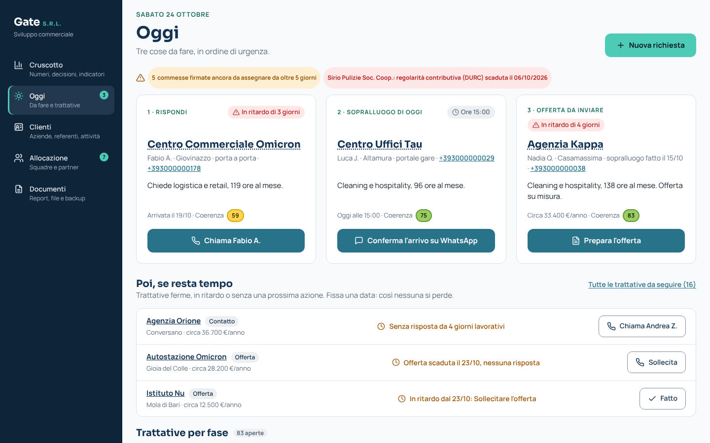
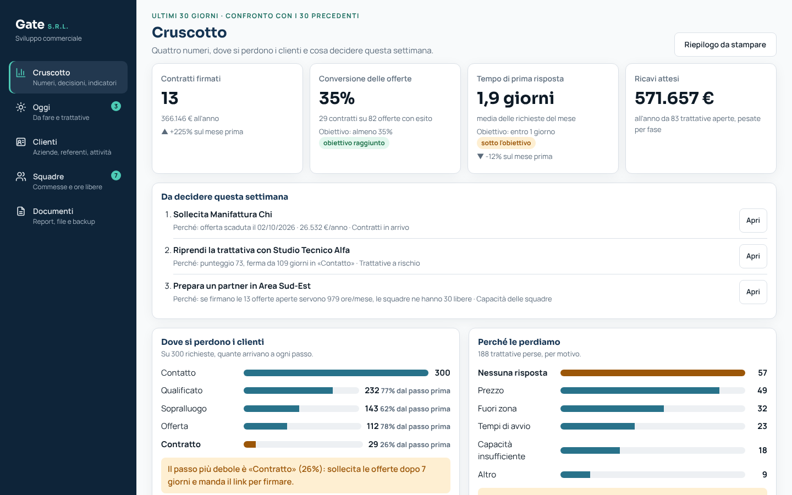
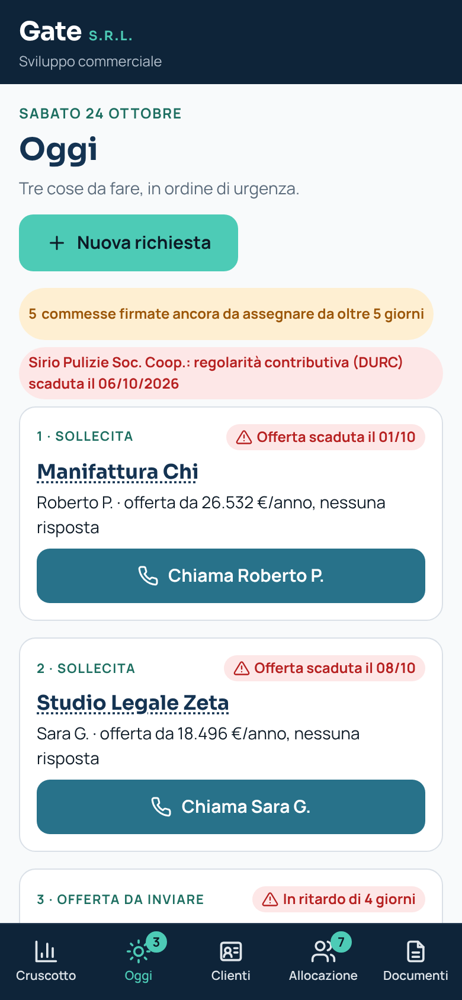

# Gate · Sviluppo commerciale (prototipo)

Prototipo web per **Gate S.R.L.**: porta in digitale il percorso commerciale "dai contatti ai contratti", dalla richiesta del cliente alla commessa affidata a chi la esegue. Ha un **database SQL** interrogabile con SQLite o MySQL. L'app e le query lavorano sugli **stessi dati**.

> **Dati fittizi.** Clienti, referenti, squadre, partner, valori, margini, ore e numeri di telefono sono inventati a scopo dimostrativo e non sono dati reali di Gate. Gli andamenti del database sono inseriti apposta per verificare il metodo (vedi `docs/dati-generati.md`). Il logo è provvisorio: verrà sostituito da quello ufficiale solo previo permesso di Gate.



## Il problema

Oggi Gate acquisisce commesse da portali di gara, con attività "porta a porta" e tramite intermediari. La sfida proposta da Gate: **come acquisire nuovi clienti e posizionarsi come partner nella gestione delle strutture**, partendo da un settore e un territorio pilota (ipotesi: uffici e studi professionali a Bari, nel database "uffici e commercio").

Gate ha chiesto tre risultati:
- un piano commerciale pilota;
- un percorso di vendita nel CRM;
- una dashboard delle opportunità "dai contatti ai contratti".

Il vincolo: acquisire solo clienti coerenti con la capacità operativa e la marginalità attesa.

**Regola di adozione:** al cliente non si chiedono app, account o password.
- La richiesta arriva dal modulo "Richiedi un sopralluogo" o da WhatsApp Business ed entra nel CRM con il canale di origine.
- L'offerta si firma da un link.
- La tecnologia nuova sta tutta dal lato di Gate.

## I componenti

| Componente | Cosa fa | Slide del deck (ipotesi da confermare) |
|---|---|---|
| **Database** (`data/gate.db`, `data/gate_mysql.sql`) | 13 tabelle: clienti, referenti, commerciali, opportunità con storico delle fasi, offerte, attività, costi dei canali. Poi i dizionari dei **canali** e dei **contenuti**, il **catalogo dei KPI** e le **richieste reali** importate. Si apre con DB Browser for SQLite o si carica in MySQL. | 26 (KPI di partenza), 27, 30 |
| **Catalogo dei KPI** (`kpi_catalogo`, `docs/kpi.md`) | 17 KPI con domanda di business, formula, livello della piramide di Anthony, tipo (efficacia, efficienza, adozione), processo APQC e soglia. È la fonte unica per SQL, app e Power BI. | 34-35 (TO-BE e KPI) |
| **Modulo "Richiedi un sopralluogo"** (`sopralluogo.html`) | Modulo breve, senza registrazione: azienda, settore, comune, tipo di ambienti, metri quadri, frequenza, referente, contatto e consenso privacy con informativa breve. Legge dal link `utm_source`, `utm_campaign` e `utm_content` e prepara il messaggio per WhatsApp o per email. | 40 |
| **Modulo "Richiedi un preventivo"** (`modulo.html`) | Secondo modulo, distinto (decisione del team), per chi conosce già servizio e ore. | 40 |
| **Oggi** | La schermata di apertura (23/10, era la Pipeline; `#pipeline` resta un indirizzo valido). In cima la data del giorno e **«Nuova richiesta»**, che apre la richiesta da nota. Poi **al massimo 3 schede d'azione**, in ordine di urgenza, ognuna con **un solo pulsante**: *Rispondi* (richiesta senza prima risposta oltre un giorno lavorativo, K12) → «Chiama …» registra la chiamata con l'ora; *Sopralluogo di oggi* (in agenda per oggi) → «Conferma l'arrivo su WhatsApp» con il messaggio già scritto, oppure «Registra le misure»; *Offerta da inviare* (sopralluogo fatto, offerta da preparare) → «Prepara l'offerta»; i posti liberi vanno a *Sollecita* (offerta scaduta o in scadenza entro 3 giorni) e ai promemoria scaduti o di oggi («Fissa il sopralluogo», «Chiama …», «Fatto»). Una scheda chiusa resta al suo posto con il riquadro verde dell'esito e «Annulla» (finché l'avviso in basso è visibile: poi resta solo l'esito); «Chiama …» chiude il promemoria con l'ora, senza una seconda riga di cronologia; il pallino del menu conta le schede ancora aperte (0-3). Da telefono ogni scheda ha una riga sola, nel colore del testo, con il referente e la sintesi della richiesta. Sotto, **«Poi, se resta tempo»**: le trattative da seguire (ricontatto scaduto, ferme, senza prossima azione, richieste senza risposta, promemoria e offerte scadute rimasti fuori dalle schede; un promemoria di un cliente senza trattative aperte, come il rinnovo, compare con il nome dell'azienda), ciascuna con il motivo in una frase e un pulsante per situazione («Fissa la prossima azione», «Fissa il sopralluogo», «Sollecita»…), l'esito verde in riga dopo l'azione, 3 righe e «Tutte le trattative da seguire (N)»; nelle prime righe stanno prima le cose scadute o di oggi rimaste fuori dalle schede (seconda richiesta senza risposta, promemoria, offerte scadute), poi i ricontatti scaduti, poi le trattative ferme da più tempo, in fondo quelle con una scadenza futura. Se non c'è nulla di urgente: «Niente di urgente oggi». Una riga di **avvisi** compare solo quando serve (commesse firmate non assegnate da oltre 5 giorni, partner che non rispondono da oltre 2 giorni, regolarità contributiva (DURC) dei partner scaduta o in scadenza entro 30 giorni; soglie in `js/config.js`, `avvisi`); le sigle del dizionario si scrivono in parole (`etichetteSettori` in `js/config.js`: GDO → grande distribuzione). In fondo le **trattative per fase**: Contatto → Qualificato → Sopralluogo → Offerta → Contratto (più Perso). Ogni richiesta ha **canale** e **data della richiesta** obbligatori, la **data di annotazione** (oggi, modificabile) e, se c'è, la **data della prima risposta**; la data dell'offerta si corregge da «Modifica». Ogni opportunità ha il **punteggio di coerenza da 0 a 100** (solo il numero, senza classi né livelli: decisione del 21/10), con il contributo di ogni criterio. Alla creazione si calcola il **preventivo indicativo** da metri quadri, frequenza e servizio (è una stima, con avviso se il margine è sotto il minimo). Una trattativa si può segnare **«Da ricontattare»** con una data obbligatoria: quando la data arriva compare in «Poi, se resta tempo». Dal Sopralluogo, **«Prepara l'offerta»** apre la schermata **Preventivo**: misure del sopralluogo → ore, prezzo, costo del lavoro (squadra o partner), margine e punteggio; tariffa minima e obiettivo calcolate dai costi e mediana dei contratti simili, applicabili con un clic; riepilogo per il cliente stampabile o salvabile in PDF (senza costi né margini); poi «Registra l'offerta inviata». Sotto il margine, l'**avviso di capacità**: se nessuna squadra della zona ha abbastanza ore libere al mese per l'offerta, lo dice prima dell'invio e suggerisce un partner o un avvio più avanti. In fase Offerta c'è la **firma da link**. | 42 (preventivo e classe), 43 (pipeline e firma) |
| **Cruscotto** | Al posto di Direzione e del menu Indicatori (24/10, riferimento di Claude Design): quattro numeri (contratti firmati nel mese con il confronto, conversione delle offerte e prima risposta con il loro obiettivo, ricavi attesi), **Da decidere questa settimana** (3 decisioni con il perché e un pulsante), **Dove si perdono i clienti** (un passo per fase, il più debole in evidenza con il rimedio), **Perché le perdiamo** (motivi e rimedio per il primo), **Da dove arrivano i clienti** (richieste, contratti e costi per canale), **Controllo del processo** (6 indicatori), il tempo risparmiato in una riga. «Approfondisci» apre gli Indicatori dettagliati (per amministratore e marketing). L'indirizzo #direzione apre il Cruscotto. | 44 (dashboard) |
| **Ruoli e accesso** | Al primo uso in un browser si apre «Chi sta lavorando?»: nome e uno dei 3 ruoli (24/10, `CONFIG.ruoli`). **Amministratore unico**: si apre sul Cruscotto, tutte le schermate e le operazioni che sostituiscono i dati (gestionale, backup, dati di esempio). **Commerciale**: si apre su Oggi; Clienti, Allocazione, Cruscotto, Documenti, senza operazioni delicate. **Marketing e analisi**: si apre sul Cruscotto con gli approfondimenti; Clienti in sola consultazione, Documenti con i CSV dei dati reali, sito e social. I permessi si controllano in `applica()`, il punto da cui passa ogni modifica. Senza server non è un accesso protetto: lo diventerà con l'archivio condiviso. | |
| **Scheda della trattativa** | Pagina intera (`#trattativa-<id>`, 24/10) al posto della finestra di dettaglio, che si apre dal nome di una trattativa o dal suo codice: avanzamento in 4 passi (Richiesta, Sopralluogo, Offerta, Firmato) con il passo attuale segnato; **Prossimo passo** con un solo pulsante principale che cambia con la fase (È qualificato, Fissa il sopralluogo, Sopralluogo fatto, Prepara l'offerta, Contratto firmato con Firma da link, Assegna la commessa), la prossima azione, «Ferma da N giorni» e «Segna come persa»; se persa, motivo, rimedio e «Riapri». Poi il servizio con margine e preventivo, la cronologia (prime 8), il referente con contatti e privacy, la richiesta (canale, date, prima risposta), il perché del punteggio, chi la eseguirebbe (ore libere della squadra contro le ore chieste) e le correzioni (Modifica, Torna a, Da ricontattare, Preventivo, Scheda cliente). | 42, 43 |
| **Clienti** | Su computer (da 1100 px) la scheda di un cliente si apre con l'**elenco accanto**, con ricerca per nome o comune: si passa da un cliente all'altro con un clic (riferimento di Claude Design, 24/10); da telefono resta la scheda a tutto schermo. Aziende e referenti in **righe compatte** (azienda e stato, referente con i pulsanti di contatto, opportunità e prossima azione); le prime 30, le altre con «Mostra le altre»; lo stato si filtra con i quattro riquadri in alto, contatto con un clic (Chiama, WhatsApp, Email), cronologia, prossime azioni, privacy. La finestra **Sito e social** contiene: i link tracciati per canale, il **piano dei contenuti** con il link pronto per ogni contenuto e l'importazione delle richieste. | 40 |
| **Allocazione** | Ogni contratto va prima a una **squadra interna** con ore libere nella zona. Altrimenti si propone a un'**impresa partner** su WhatsApp, che risponde SÌ o NO (solo DURC regolare, niente lavoratori autonomi; il cliente resta di Gate). Le commesse da assegnare sono righe compatte con il prossimo passo (squadra disponibile, partner da proporre, in attesa, nessun partner) che si aprono con un clic; una tendina le filtra per zona. Capacità futura, squadre e partner, commesse assegnate, registro delle proposte e portale partner stanno in riquadri richiudibili. I partner sono "in roadmap" nel PASSAGGIO 3: il team ha scelto di tenerli. Si spengono con `funzioni.partner` in `js/config.js`. | 43 |
| **Indicatori** | Si aprono dal Cruscotto («Approfondisci»). Quattro sezioni lungo il percorso del cliente. Ogni vista dice da quale fonte legge: **Dati fittizi** oppure **Dati reali** (fotografia di partenza o test), scelta dal menu «Fonte dei dati» quando ci sono dati reali importati; le righe importate restano in un elenco a parte. | 44 (dashboard) |
| **Documenti** | Tutti i file in una schermata (raccolti il 22/10, prima erano sparsi tra Indicatori, Clienti e piè di pagina). **Da stampare**: Riepilogo del mese (una pagina A4 per la direzione: ultimi 30 giorni contro i 30 precedenti, situazione di oggi, cosa fare domani) e Lista del lunedì. **Gestionale ed Excel**: i 7 CSV per il gestionale (scarica e carica), l'elenco di clienti e referenti per Excel, il CSV a 7 colonne delle richieste per gli Indicatori (scarica e carica i dati reali). **Backup**: salva e carica il backup, ripristina i dati di esempio. | |

Le sezioni degli Indicatori seguono il percorso del cliente (riorganizzate il 21/10). Ogni KPI ha il suo codice, una riga che spiega la formula in parole, la formula tecnica e il livello della piramide di Anthony in «Come si calcola»; senza dati compare «nessun dato», mai zero. Il catalogo ha 14 KPI: K14, K16 e K17 sono stati tolti il 21/10, gli altri codici non cambiano.
- **Marketing** (da dove arrivano i clienti): quota di richieste digitali K15, costo di acquisizione K4; tabella dei 7 gruppi di canale con chiusura, punteggio medio, margine e costo per contratto; per settore e per contenuto in riquadri richiudibili.
- **Fino all'offerta**: prima risposta K12, contatti qualificati K1, sopralluoghi K2, tempo fino all'offerta K13, trattative ferme K9, funnel.
- **Dall'offerta al contratto**: conversione delle offerte K3, win rate K7, durata del ciclo K8, motivi di perdita K10.
- **Cosa fare domani**: le quattro previsioni con le azioni (vedi sotto), poi pipeline ponderata K6, margine atteso K5 e trattative buone K11.
- Le liste di lavoro stanno solo in Oggi: le tre schede d'azione e «Poi, se resta tempo».

**Canali.** I 15 canali del database (12 attivi) sono raggruppati nei 7 gruppi usati da filtri, dashboard e CSV: sito, LinkedIn, telefono, email, passaparola, portale/gara, altro. Elenco e gruppi stanno in un solo punto: `CANALI_DIZIONARIO` e `GRUPPI_CANALI` in `generatore/parametri.py`.



<p>
  
  
  
  
</p>

## Piattaforma su cinque livelli (PASSAGGIO 4)

Gate riceve le richieste soprattutto per telefono e dopo incontri sul posto, e nessuno le annota in un elenco. Ha un gestionale interno introdotto da poco. Il CRM **non sostituisce il gestionale**: tiene il «modello Gate» (fasi, campi, preventivo, punteggio, KPI) e scambia i dati con il gestionale in CSV. I cinque livelli sono: canali del cliente (nessuna app) → cattura automatica → archivio unico → strumenti di lavoro → cruscotto. La pagina **Come funziona** (piè di pagina) li mostra, con il collegamento alla schermata e chi fa ogni passaggio: automatico, l'assistente propone e la persona conferma, oppure persona.

| | Cosa fa | Dove | Slide |
|---|---|---|---|
| **N1 Richiesta da nota** | Una nota scritta o dettata (con il microfono della tastiera, fuori dal browser) diventa una richiesta compilata. Le regole sono leggibili (`assistente` in `js/config.js`), senza intelligenza artificiale. Ogni campo mostra il valore, la frase da cui viene e lo stato: sicuro, da controllare o mancante. Solo «Conferma e registra» crea la trattativa; i secondi impiegati si salvano. 5 note di esempio: 9 campi su 9 corretti in ognuna. | Oggi → «Nuova richiesta» (e Nuovo contatto → «Da una nota») | TO-BE, demo |
| **N2 Offerta da pacchetto** | Pacchetti Base, Plus e Completo per uffici e studi, con prezzo al mq all'anno (valori di prova). Il prezzo nasce da mq × €/mq; ore e tariffa si ricavano da lì, così margine e punteggio restano coerenti. L'offerta stampabile ha servizi inclusi e opzionali, prezzo annuo e mensile, validità con data e condizioni, ma non il margine. «Segna l'offerta come inviata» funziona anche senza sopralluogo (le fasi saltate sono dichiarate); poi firma da link, con la scadenza del contratto a 12 mesi. | Schermata Preventivo | soluzione, demo |
| **N3 Tempo risparmiato** | Quattro attività con minuti prima e dopo (stime modificabili), volumi del mese dai dati, ore ed euro risparmiati e la formula in parole. «Annotare una richiesta» usa la media dei secondi veri dopo 3 richieste da nota. Con i valori di partenza: **59,9 ore e 1.497 € al mese**. | Indicatori → Cosa fare domani; una riga nel Riepilogo del mese | soluzione e piattaforma |
| **N4 Lista del lunedì** | Quattro sezioni alla data scelta: richieste senza prima risposta (giorni lavorativi), trattative ferme, offerte senza esito da oltre 14 giorni, contratti da rinnovare entro 90 giorni (quelli entro 60 in evidenza). Ordine: prima le trattative buone, poi per valore. Si stampa o si copia come testo. Su questi dati: 0, 6, 11 e 12 righe al 19/10; 6, 20, 12 e 9 al 13/10 (uguali in app e database). | Documenti → Lista del lunedì | TO-BE, demo |
| **N5 Ponte con il gestionale** | Export di 7 CSV con i nomi del dizionario: le 5 tabelle richieste più storico delle fasi e commerciali, per non perdere date e responsabili. L'import controlla tipi, valori ammessi e collegamenti, elenca le righe scartate con il motivo e sostituisce i dati di lavoro dopo aver scaricato un backup. Stessa logica in `strumenti/ponte_gestionale.py`. | Documenti → Dati per il gestionale | soluzione e piattaforma |
| **N6 Come funziona** | I 5 livelli, chi fa ogni passaggio e la demo guidata in 7 passi (nota → preventivo → pacchetto → firma → chi esegue → indicatori → tempo risparmiato), sotto i 90 secondi. | Piè di pagina → Come funziona | demo |
| N7 Report mensile al cliente | Non fatto: era opzionale. Il Riepilogo del mese per la direzione ne è la base. | | |

Dati aggiunti: 12 **contratti in corso** dei clienti storici (tabella `contratti_in_corso`, firmati tra 11/2025 e 1/2026), la **scadenza dei contratti** (`opportunita.data_scadenza_contratto`), il **pacchetto** dell'offerta (`offerte.pacchetto`) e i **tempi di registrazione** (`tempi_registrazione`). Le altre tabelle restano identiche, quindi i KPI già verificati non cambiano.

## Il flusso della demo (meno di 90 secondi)

1. **Il cliente chiede un sopralluogo.** Apre `sopralluogo.html` dal link di un post LinkedIn (`?utm_source=linkedin&utm_campaign=uffici-e-commercio&utm_content=prova-03`) e invia la richiesta su WhatsApp.
2. **La richiesta entra nel CRM.** In Clienti → Sito e social si incolla il messaggio e si preme Importa. Nasce un'opportunità in **Contatto** con canale, campagna, contenuto, data di registrazione di oggi e consenso. Ha già il **preventivo** e il **punteggio**.
3. **La trattativa avanza in Oggi, tra le trattative per fase:** È qualificato → Sopralluogo fatto → Offerta inviata → **Firma da link** → Contratto.
4. **Allocazione e Indicatori.** In Allocazione la commessa va a una squadra o a un partner. Negli **Indicatori** («Dall'offerta al contratto») il nuovo contratto entra nella conversione delle offerte K3; in «Marketing» il contenuto compare tra le richieste qualificate.

## Archivio condiviso in MySQL

Per l'uso con il team di Gate i dati passeranno dal browser a un database **MySQL**. Lo schema è pronto: `data/archivio_mysql.sql` (28 tabelle, tutti i dati e le impostazioni dell'app, con chiavi, vincoli e chi-quando di ogni modifica). `python3 strumenti/archivio.py esporta backup.json impostazioni.json > dati.sql` converte un backup dell'app in INSERT. `python3 prove/archivio.py` lo prova su un MariaDB vero: andata e ritorno senza perdite, KPI identici, 16 dati sbagliati rifiutati. Cosa resta (server, login, permessi, id, conflitti, backup) in `docs/schema-archivio.md`.

## Cosa fare domani

L'ultima sezione degli Indicatori ragiona in avanti con i dati di oggi. Quattro previsioni, ognuna con il dato su cui si basa e le azioni che ne seguono:
1. **Contratti in arrivo**: offerte aperte × conversione delle offerte (K3) → offerte da sollecitare.
2. **Trattative a rischio**: trattative ferme oltre la soglia della fase (K9) e ricavi attesi in gioco → trattative da riprendere, rimedio al motivo di perdita prevalente.
3. **Capacità delle squadre**: ore delle offerte aperte, se firmate, contro le ore libere per zona → partner da preparare.
4. **Nuovi contatti il prossimo mese**: media degli ultimi 3 mesi × trattative chiuse con un contratto (K7) → budget da spostare tra canali.

Sotto restano K6, K5 e K11. Le previsioni proiettano i tassi di oggi; le azioni sono regole leggibili in `js/analisi.js`, con le soglie in `js/config.js`. Nelle altre sezioni non ci sono etichette («Cosa è successo?» ecc.): i dati si spiegano da soli.

Il **punteggio di coerenza** (0–100) ha il colore pieno della sua fascia: bassissimo (0–29, rosso), basso (30–49, arancione), medio (50–69, giallo), alto (70–84, verde chiaro), altissimo (85–100, verde scuro). Una **trattativa buona** ha punteggio da **70** in su (decisione del 21/10): è la base del K11 (quota di trattative buone) e delle trattative da riprendere in «Cosa fare domani». La soglia 70 è in `generatore/parametri.py` (`SOGLIA_BUONA`), uguale per app e SQL; le fasce in `js/config.js` (`punteggio.fasce`).

## Collegamento con la deliverable del corso

| Task della deliverable | Dove si trova nel progetto |
|---|---|
| Processi AS-IS e TO-BE (BPM, APQC) | **AS-IS:** i tempi di risposta e di registrazione oggi, misurati sulla **fotografia di partenza** (`richieste_reali`, fonte partenza). **TO-BE:** modulo, registrazione immediata, preventivo, firma da link e report; il test di tre settimane li misura (fonte test). |
| KPI (APQC e KPI compendium) | `kpi_catalogo` e `docs/kpi.md`: ogni KPI ha il processo APQC, categoria 3.0 Market and Sell (dove il PASSAGGIO lo indica, "da verificare sul PCF"). |
| Piramide di Anthony | Il livello di ogni KPI (operativo, tattico, strategico) in «Come si calcola» e nella colonna `livello_anthony` del catalogo; le sezioni seguono il percorso del cliente. |
| Piattaforma e platform thinking | Cliente senza app (modulo e WhatsApp), partner via WhatsApp, CRM come punto unico dei dati, canali tracciati con utm senza pixel. |
| Roadmap della trasformazione | Le **evoluzioni previste:** portale partner (solo come visione, non nel prototipo), lead scoring con modello statistico, archivio condiviso online. |
| Digital gap | La quota di richieste digitali (K15) e il tempo di prima risposta (K12), prima e dopo il test. |

## Interrogare il database con SQL

Il database è uno solo e si può usare in tre modi, dal più semplice:

1. **DB Browser for SQLite** (gratuito, nessuna installazione di server). Apri `data/gate.db` e scrivi le query nella scheda "Esegui SQL".
2. **MySQL o MariaDB.** Carica `data/gate_mysql.sql`, provato su MariaDB:
   - con **MySQL Workbench**: *File → Open SQL Script → esegui*;
   - da terminale: `mysql -u root -p < data/gate_mysql.sql`.

   Crea il database `gate` con tipi veri (DATE, DECIMAL), chiavi primarie ed esterne.
3. **Power BI o Excel.** Importa i CSV di `data/csv/`, uno per tabella.

**Differenze tra i dialetti:**
- I giorni tra due date si calcolano con `julianday(fine) - julianday(inizio)` in SQLite e con `DATEDIFF(fine, inizio)` in MySQL.
- I campi vuoti sono `NULL` in entrambi: si cercano con `IS NULL`, non con `= ''`.

## Rigenerare i dati e importare i dati veri

```
python3 generatore/genera_dati.py        # database, CSV, copia MySQL, js/dizionari.js, js/dati-db.js, docs/kpi.md
python3 generatore/controlla_dati.py     # controlli: deve finire con "tutti i controlli superati"
python3 generatore/importa_richieste.py data/esempi/richieste-partenza-esempio.csv
python3 generatore/importa_richieste.py data/esempi/richieste-test-esempio.csv --voti data/esempi/voti-test-esempio.csv
```

- **Parametri e dizionari.** Stanno in `generatore/parametri.py`: canali, settori, servizi, comuni, fasi, pesi del punteggio e ipotesi H1–H5. Con lo stesso seme i dati sono identici. L'app legge gli stessi dizionari da `js/dizionari.js`: si cambia un solo file e si rilancia il generatore.
- **Dati veri (fotografia di partenza e test).** Si scrivono in un CSV con le 7 colonne del foglio condiviso: `data_richiesta, data_annotazione, canale, settore, data_risposta, data_offerta, esito` (il canale può essere anche uno dei 7 gruppi). Le date possono essere scritte `AAAA-MM-GG` o `GG/MM/AAAA`. Il CSV si importa in due modi: **nell'app** (Documenti → Richieste per gli Indicatori → «Carica dati reali», con il controllo delle righe e l'elenco a parte) oppure **nel database** con lo script qui sopra (`--fonte partenza` o `--fonte test` se il file non ha la colonna fonte).
- **Controlli dell'import.** Controlla date, canali, settori ed esiti, stampa le righe scartate con il motivo e sostituisce le righe già importate con la stessa fonte. I voti di facilità arrivano da un secondo CSV facoltativo (`fonte, riga, voto_facilita`).
- **I CSV di esempio.** Quelli in `data/esempi/` sono **inventati**: servono a provare l'import prima dei dati veri, e l'app li segnala come esempio. Nel CSV del test c'è apposta una riga sbagliata.
- **Il database si rigenera senza perdere i dati veri.** `genera_dati.py` conserva la tabella `richieste_reali`. I dati reali non si mescolano mai con quelli fittizi.
- **Attenzione alla privacy.** Il prototipo pubblicato su GitHub Pages contiene `js/dati-db.js`. Con dati personali veri il prototipo **non va pubblicato**: si usa in locale, previa verifica GDPR con Gate.

## Ipotesi nei dati fittizi

| Ipotesi | Parametro | Sui dati generati |
|---|---|---|
| H1 il passaparola converte in contratto più di ogni altro canale | `PASSAGGIO_PER_CANALE` | passaparola 24,2%, il primo canale |
| H2 negli uffici LinkedIn converte meglio del porta a porta | `BOOST_LINKEDIN_UFFICI` | 25,0% contro 3,7% |
| H3 la classe A chiude più spesso della classe C | `EFFETTO_PUNTEGGIO` | A 16,8%, B 11,1%, C 0% |
| H4 l'intermediario ha il margine più basso | `MARGINE_PER_CANALE` | 15,5%, contro 18–22% degli altri canali |
| H5 i nuovi contatti crescono di mese in mese | `CRESCITA_CONTATTI` | da 2 a marzo a 72 a settembre (ottobre parziale) |
| H6 nella GDO il portale gare converte meno ma con margine più alto | **non inserita: test cieco** | il portale gare usa la media degli altri canali in tutti i settori |

Trattative aperte: 83 opportunità aperte su 300 (96% contattate da agosto), chiusura 13,4% sulle chiuse, 12% delle aperte ferme.

## Come avviarlo

- **In locale:** apri `index.html` con un doppio clic, non serve installare nulla.
- **Da mandare ad Alfredo o a un esterno:** `python3 strumenti/versione_unica.py` crea in `dist/` il CRM in un file solo (`gate-crm-prototipo.html`) e i due moduli pubblici (`sopralluogo.html`, `modulo.html`): si mandano insieme, nella stessa cartella. Si aprono con un doppio clic, anche senza internet (senza internet i caratteri diventano quelli di sistema). Al primo avvio chiede chi sta lavorando; i dati restano nel browser di quel computer, con il backup in Documenti per passarli a un collega. Browser: Chrome o Edge aggiornati (dalla versione 117), Safari dalla 16.4, Firefox dalla 121. Provato in automatico: primo accesso, richiesta da nota fino alla firma, riapertura con i dati salvati, modulo pubblico, a 1366 e 390 px, con e senza internet.
- **Online, con GitHub Pages:** *Settings → Pages → Deploy from a branch*, cartella `/ (root)`.
- **Dove stanno i dati.** I dati del CRM restano nel browser (localStorage). In **Documenti → Backup**:
  - **Salva backup** (il piè di pagina lo ricorda, con il pulsante, se l'ultimo backup è di oltre 7 giorni fa);
  - **Carica backup**;
  - **Ripristina**: riparte dai dati di esempio, con le date spostate in modo che il 19/10/2026 coincida con oggi.
- **Browser che avevano la versione precedente.** Un avviso propone di passare ai nuovi dati, senza cancellare quelli salvati.
- **Prove automatiche.** Si avviano con `NODE_PATH=$(npm root -g) node prove/e2e.js`, con il server locale `python3 -m http.server 8765 --bind 127.0.0.1` acceso. Coprono:
  - il flusso della demo;
  - l'app uguale al database;
  - le fonti reali;
  - i partner spenti;
  - la migrazione;
  - i contenuti.

  Tutto a 1440×900 e 390×844, con zero errori in console. `FOTO=1` rifà gli screenshot.

## Gate può usarlo davvero?

Per il pilota sì, da una persona alla volta: registra clienti, trattative e attività, con backup ogni sera.

**Limiti:**
- un browser, una copia dei dati;
- nessun login;
- promemoria solo dentro l'app;
- un servizio per opportunità;
- costi, soglie, rese del preventivo e tariffe sono **valori di prova, da sostituire dopo l'intervista**.

**Passi successivi:**
1. un archivio condiviso online con login, per esempio Python e un database MySQL, riusando lo stesso schema;
2. il collegamento al gestionale di Gate;
3. i webhook, così che modulo e campagne scrivano direttamente nel CRM.

## Struttura dei file

```
index.html              il CRM: Oggi, Clienti, Allocazione, Cruscotto, Documenti (Indicatori dal Cruscotto); accesso per ruolo
sopralluogo.html        modulo pubblico "Richiedi un sopralluogo" (utm_source, utm_campaign, utm_content)
modulo.html             modulo pubblico "Richiedi un preventivo"
css/stile.css           palette e font del sito Gate (variabili in cima al file)
js/dizionari.js         GENERATO: canali, settori, servizi, comuni, fasi, pesi del punteggio (uguali al database)
js/dati-db.js           GENERATO: le tabelle del database per l'app
js/archivio.js          dove stanno i dati (oggi questo browser), chi lavora, registro delle modifiche
js/config.js            ipotesi dell'app: squadre, partner, preventivo, obiettivi, consigli, funzioni.partner
js/formato.js           euro, percentuali e date
js/dati.js              stato, dati iniziali dal database, migrazione, backup, CSV, doppioni, privacy
js/allocazione.js       squadre, partner, DURC, messaggio WhatsApp
js/punteggio.js         preventivo indicativo, margine e punteggio di coerenza (0-100)
js/kpi.js               KPI del catalogo (fittizi e reali), funnel, canali, contenuti, settori
js/analisi.js           «Cosa fare domani», tempo risparmiato, lista del lunedì, Come funziona
js/clienti.js           schermata Clienti (e la riga di attività riusata dalla scheda cliente)
js/oggi.js              schermata Oggi: regola delle 3 schede d'azione, «Poi, se resta tempo», giornata libera
js/canali.js            sito e social: link tracciati, piano dei contenuti, import delle richieste
js/assistente.js        richiesta da nota: regole di estrazione e scheda da confermare
js/ponte.js             ponte con il gestionale: CSV del dizionario, controlli, import
js/indicatori.js        Indicatori, Cruscotto, Riepilogo del mese, Lista del lunedì
js/preventivi.js        schermata Preventivo: conti, prezzi di riferimento, riepilogo da stampare
js/documenti.js         schermata Documenti: report da stampare, gestionale, Excel, CSV dei dati reali, backup
js/app.js               trattative per fase, Allocazione, finestre, firma da link, applica() con Annulla, eventi
generatore/             parametri.py, genera_dati.py, kpi_catalogo.py, esporta.py, importa_richieste.py, controlla_dati.py
data/                   gate.db (SQLite), gate_mysql.sql (MySQL), csv/, esempi/
docs/                   kpi.md, dati-generati.md, backlog.md, esercizi-k12-k13-k15.md, passaggi/, ritorni/, screenshot/
sql/  export/           le query di Nicolò e i CSV per Power BI
prove/e2e.js            prove automatiche (Playwright)
strumenti/              versione in un solo file, archivio MySQL, ponte con il gestionale in Python
```

## Progetto

Prototipo realizzato per l'**Open Challenge by Enterprise 2026**, corso di Digital Transformation, laurea magistrale LM-77, Università LUM, con Gate S.R.L. come azienda partner.
