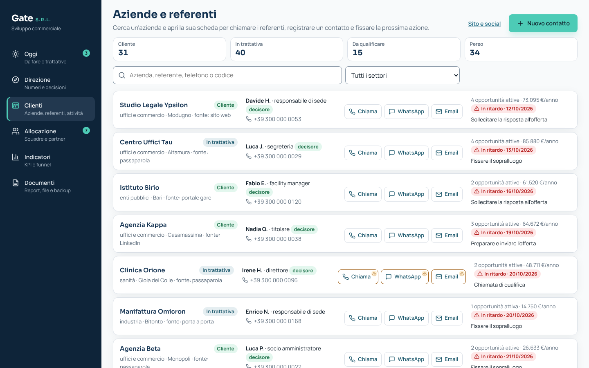
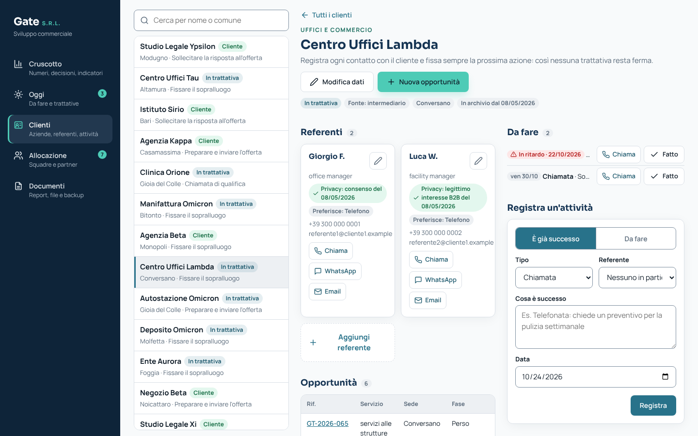
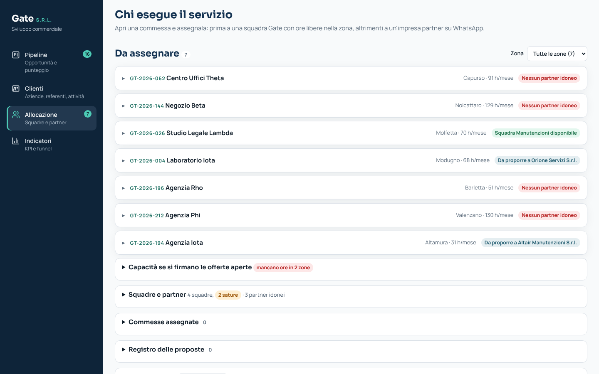
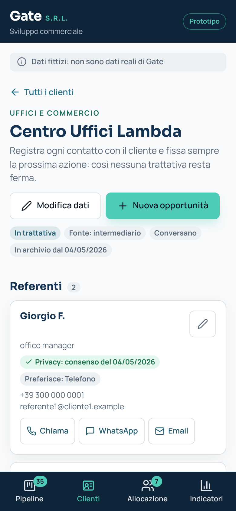

# Gate · Sviluppo commerciale (prototipo)

Prototipo web per **Gate S.R.L.**: porta in digitale il percorso commerciale "dai contatti ai contratti", dalla prima richiesta alla commessa affidata a chi la esegue.

> **Dati fittizi.** Clienti, partner, squadre, valori, margini, ore e numeri di telefono sono inventati a scopo dimostrativo e non sono dati reali di Gate. Il logo è provvisorio: verrà sostituito da quello ufficiale solo previo permesso di Gate.


## Il problema

Oggi Gate acquisisce commesse da portali di gara, con attività "porta a porta" e tramite intermediari. La sfida proposta da Gate: **come acquisire nuovi clienti e posizionarsi come partner nella gestione delle strutture**, partendo da un settore e un territorio pilota (ipotesi: uffici e studi professionali a Bari).

Gate ha chiesto tre risultati:
- un piano commerciale pilota;
- un percorso di vendita nel CRM;
- una dashboard delle opportunità, misurata "dai contatti ai contratti".

C'è anche un vincolo: acquisire solo clienti coerenti con la capacità operativa e la marginalità attesa.

## La soluzione

Quattro schermate:

| Schermata | Cosa fa |
|---|---|
| **Pipeline** | Le opportunità passano per le fasi Contatto → Qualificato → Sopralluogo → Offerta → Contratto (più Perso). Ogni opportunità ha un **punteggio di coerenza A/B/C** su 6 criteri: settore pilota, distanza da Bari, capacità disponibile, margine stimato, dimensione della commessa, decisore identificato. In alto ci sono la **previsione ponderata** (valore annuo × probabilità della fase), "Da fare oggi" e "Da seguire". |
| **Clienti** | L'anagrafica: aziende con i loro **referenti** (ruolo, decisore, telefono, email, canale preferito, privacy), pulsanti **Chiama / WhatsApp / Email** con un clic, **cronologia delle attività** e **prossime azioni** con data. La ricerca trova anche telefono, ruolo e codice dell'opportunità; i riquadri del riepilogo (Cliente, In trattativa, Da qualificare, Perso) fanno da filtro. |
| **Allocazione** | Ogni contratto firmato va prima a una **squadra interna** con ore libere nella zona. Se non c'è capacità, il coordinatore lo propone a un'**impresa partner** con un messaggio **WhatsApp precompilato** (link wa.me). Il partner risponde SÌ o NO senza usare nessuna app; se risponde NO, il sistema propone il partner successivo. Sono ammesse solo imprese con DURC regolare, nessun lavoratore autonomo. Il cliente resta di Gate, che firma il contratto e controlla la qualità. |
| **Indicatori** | In testa **"Il pilota in sintesi"**: quanti dei 5 obiettivi sono raggiunti, un suggerimento per ogni obiettivo mancato e la previsione ponderata. Poi i 5 KPI richiesti da Gate, divisi in **efficacia** (contatti qualificati, sopralluoghi, conversione delle offerte) ed **efficienza** (costo di acquisizione, margine atteso), ciascuno con la formula e i numeri. Infine il funnel, la tabella **"Perché perdiamo"** e i risultati per settore e per **canale di acquisizione**. |

Il portale per i partner compare solo come anteprima, etichettata "evoluzione futura".






<p>
  
  
  
  
</p>

## Come si lavora

- **Le fasi si registrano a cose fatte.** I pulsanti dicono cosa è già successo: "È qualificato", "Sopralluogo fatto", "Offerta inviata", "Contratto firmato". Ogni passo chiede la data e i dati utili (ore confermate al sopralluogo, importo e validità dell'offerta, data di avvio del servizio). Un'opportunità di classe C passa a Offerta solo con una motivazione scritta. Il sopralluogo si può fissare in agenda prima di farlo.
- **Ogni trattativa ha una prossima azione.** Quando si chiude l'ultima attività di un cliente in trattativa, il prototipo chiede "Qual è la prossima azione?". Dopo ogni fase crea da solo il promemoria giusto (per esempio "Sollecitare la risposta all'offerta"). Il riquadro **Da seguire** elenca le trattative senza prossima azione o ferme da troppo tempo.
- **Annulla.** Dopo ogni modifica compare per 8 secondi un avviso con "Annulla", che riporta tutto com'era, schermata compresa. Un doppio clic non registra due volte la stessa azione.
- **Correzioni.** Dal dettaglio di un'opportunità si può tornare alla fase precedente, riaprire una trattativa persa o modificare servizio, ore e tariffa. Ogni correzione lascia una riga nella cronologia.
- **Niente doppioni.** Mentre si scrive un nuovo contatto compare "Forse esiste già" con le aziende simili (stesso nome, P.IVA, telefono o email). Stesso nome o stessa P.IVA bloccano il salvataggio. Un contatto si può salvare anche con "Servizio ancora da capire": diventa un'azienda "Da qualificare" con la chiamata di qualifica in agenda.
- **Registrare un'attività.** Nella scheda cliente si sceglie "È già successo" oppure "Da fare" (che fissa la prossima azione, da domani). Il testo scritto non si perde finché non si registra, e tornando all'elenco ricerca e filtri restano quelli di prima.
- **Privacy.** Per ogni referente si registrano base giuridica, data, modo di raccolta ed eventuale opposizione alle proposte. Senza privacy verificata i pulsanti di contatto hanno un bordo ambra. "Cancella i dati personali" e "Elimina azienda" applicano il diritto alla cancellazione, con una conferma dentro la pagina.
- **Indicatori con tutti i contatti.** I contatti sono le opportunità più le aziende ancora da qualificare (per esempio 16 + 2 = 18): così funnel, KPI e risultati per canale contano anche chi non ha ancora un'opportunità.
- **Da telefono.** Navigazione in basso, campi a 16 px (l'iPhone non ingrandisce la pagina), tabelle che diventano schede, pulsanti alti almeno 44 px. Focus visibile, contatori e punteggi leggibili dai lettori di schermo; una prova con un lettore di schermo reale e su iPhone resta da fare.

## Le quattro domande dell'analisi

Ogni sezione del CRM dice a quale domanda risponde, con un'etichetta colorata:

1. **Cosa è successo?** (descrittiva): KPI, funnel, pilota in sintesi.
2. **Perché è successo?** (diagnostica): perché perdiamo, risultati per settore e per canale, criteri del punteggio A/B/C.
3. **Cosa succederà?** (predittiva): previsione ponderata dei ricavi, ore che serviranno alle squadre se si firmano le offerte aperte.
4. **Cosa conviene fare?** (prescrittiva): consigli proattivi nella Pipeline e negli Indicatori, per esempio "Sollecita Poliambulatorio Zeta · Perché: offerta scaduta". Ogni consiglio nasce da una regola leggibile (`js/analisi.js`, soglie in `config.js`), non da una scatola nera.

## Collegamento con sito e social

Senza un server i contatti non possono entrare nel CRM da soli. Il prototipo usa un collegamento semplice, adatto al pilota:

1. **Modulo "Richiedi un preventivo"** (`modulo.html`): una pagina pubblica da collegare al sito, alla bio di Instagram, ai post e alle campagne. Chi la compila invia la richiesta a Gate su **WhatsApp o per email**, con il messaggio già scritto e il consenso privacy.
2. **Link tracciati per canale**: in Clienti → **Sito e social** c'è un link per ogni canale (sito, Facebook, Instagram, LinkedIn, Google Ads), per esempio `modulo.html?utm_source=instagram`. Il canale viaggia nel messaggio.
3. **Importazione**: nella stessa finestra si incollano le richieste ricevute oppure si carica il **CSV esportato dalle campagne** (Meta Lead Ads per Facebook e Instagram, LinkedIn Lead Gen Forms). Il CRM crea le aziende "Da qualificare" con la fonte giusta, il referente, la nota della richiesta e una chiamata di qualifica per domani; i doppioni vengono esclusi.

Così gli indicatori per canale mostrano quali social portano contratti e a che costo. Numero WhatsApp ed email di Gate, canali e costi sono in `config.js` (oggi fittizi).

**Passo successivo** (con un archivio online): il modulo e le campagne scrivono direttamente nel CRM tramite un collegamento automatico (webhook), senza copia e incolla.

## Come avviarlo

- **In locale:** scarica la cartella e apri `index.html` con un doppio clic. Non serve installare nulla.
- **Online, con GitHub Pages:** nel repository vai in *Settings → Pages*, scegli *Deploy from a branch*, seleziona il branch e la cartella `/ (root)` e salva. Dopo un minuto il sito è disponibile all'indirizzo che GitHub mostra in quella pagina.

I dati restano nel browser di chi usa il prototipo (localStorage): non c'è nessun server. In fondo alla pagina ci sono tre pulsanti:
- **Salva backup**: scarica tutti i dati in un file `.json`;
- **Carica backup**: ripristina i dati da quel file, anche su un altro computer (si può annullare);
- **Ripristina dati di esempio**: riparte dai dati fittizi (si può annullare).

Accanto ai pulsanti il **promemoria del backup** dice quando è stato fatto l'ultimo ("oggi", "ieri", "N giorni fa", "mai") e invita a farne uno dopo 7 giorni. Se il browser non riesce a salvare, o se i dati salvati non si leggono, un avviso in cima alla pagina lo dice subito e permette di scaricare una copia: i dati non vengono mai scartati in silenzio.

Nella schermata Clienti, **Esporta per Excel** scarica aziende e referenti in un file CSV; le celle che iniziano con `=`, `+`, `-` o `@` non diventano formule in Excel. La partita IVA esce con il prefisso `IT` (es. `IT01234567890`) e i telefoni con gli spazi (es. `0039 000 000 1011`), così Excel non toglie gli zeri iniziali; se si importa il file in altro modo, impostare queste colonne come «Testo».

## Gate può usarlo davvero?

Sì, per il pilota e da una persona alla volta. Il coordinatore commerciale può registrare clienti, referenti, attività e trattative reali, salvare il backup ogni sera e passarlo a un collega, ed esportare l'elenco per Excel.

### Limiti

- **Un browser, una copia dei dati.** Il prototipo non condivide i dati tra più persone né tra computer e telefono: si passano con il backup. Se due persone lavorano su copie diverse, una sovrascrive l'altra.
- **Nessun login e nessun registro delle modifiche.** Chiunque usi quel browser vede e modifica tutto; "Annulla" torna indietro di un solo passo.
- **Promemoria solo dentro l'app.** Le prossime azioni non arrivano sul telefono come notifiche.
- **Un servizio per opportunità.** Offerte con più servizi, rinnovi e scadenze dei contratti non sono gestiti.
- **Ipotesi da confermare.** Costi, obiettivi, soglie del punteggio, giorni oltre i quali una trattativa è "ferma" e suggerimenti degli indicatori sono ipotesi in `js/config.js`, da concordare con Gate.
- **Privacy.** Prima di inserire dati personali reali va verificato con Gate e con il suo consulente il rispetto del GDPR: informativa, base giuridica e luogo dove sono conservati i dati (oggi nel browser e nei file di backup).

### Passi successivi

1. **Un archivio condiviso online con login**: un piccolo server con database al posto del salvataggio nel browser, con utenti, ruoli e registro delle modifiche. Potrebbe essere realizzato in Python (per esempio con Django), riusando le stesse regole del prototipo (punteggio, allocazione, KPI).
2. **Il collegamento al gestionale di Gate**, così che un contratto firmato diventi direttamente una commessa nelle sezioni Contratti e Pianificazione Personale, senza ricopiare i dati.
3. Poi, nell'ordine: promemoria nel calendario del telefono, importazione dei contatti da Excel, indicatori nel tempo (ciclo di vendita, previsione per mese).

## Stack

HTML, CSS e JavaScript puro, senza framework né compilazione: si apre con un doppio clic e si pubblica gratis su GitHub Pages così com'è. Chiunque nel team può leggere e spiegare ogni file senza conoscere strumenti aggiuntivi.

Colori e font riprendono il sito [gatesrl.it](https://www.gatesrl.it/): blu notte, blu petrolio e acquamarina; Sora per i titoli e Manrope per il testo.

## Struttura dei file

```
modulo.html         modulo pubblico "Richiedi un preventivo" per sito e social
index.html          struttura della pagina e menu
css/stile.css       palette e font del sito Gate (variabili in cima al file)
js/config.js        IPOTESI E DATI DI ESEMPIO: l'unico file da modificare con i dati reali
js/formato.js       formattazione di euro, percentuali e date
js/dati.js          salvataggio nel browser, collegamenti tra aziende/referenti/opportunità, backup ed esportazione
js/allocazione.js   regole di allocazione: squadre, partner, DURC, messaggio WhatsApp
js/punteggio.js     stime economiche e punteggio di coerenza A/B/C
js/kpi.js           5 KPI, obiettivi del pilota, funnel, motivi di perdita, risultati per settore e canale
js/canali.js        collegamento con sito e social: link tracciati, importazione richieste e CSV delle campagne
js/analisi.js       le quattro domande: etichette, previsione della capacità, consigli "Cosa conviene fare?"
js/clienti.js       schermata Clienti: elenco con ricerca e filtri, scheda cliente, referenti, attività, privacy
js/app.js           schermate Pipeline, Allocazione e Indicatori, finestre e clic
```

## Come sostituire i dati con quelli reali

Tutto si trova in `js/config.js`, con un commento per ogni voce:

- **tariffe e costi orari** per servizio (squadra interna e partner) e spese dirette;
- **pesi e soglie del punteggio** A/B/C, compresa la conferma motivata per i clienti C (`confermaPerPunteggioC`);
- **fasi**: probabilità di chiusura, giorni oltre i quali una trattativa è "ferma" e promemoria automatici;
- **costi commerciali** per il costo di acquisizione, **obiettivi** dei KPI e **suggerimenti** mostrati quando un obiettivo non è raggiunto;
- **basi giuridiche** e **modi di raccolta** della privacy;
- **comuni e zone**, **squadre** (ore di capacità e già impegnate), **partner** (tipo, zone, servizi, scadenza DURC, telefono);
- **testo del messaggio WhatsApp**;
- **aziende con i referenti**, **opportunità** e **attività** di esempio;
- **canali di acquisizione** con la loro spesa e i **tipi di attività**.

Dopo aver cambiato le opportunità di esempio, premi "Ripristina dati di esempio" per caricarle. Prima di una demo dal vivo conviene mettere come telefono di un partner il numero di un membro del team, così il messaggio WhatsApp arriva davvero.

## Progetto

Prototipo realizzato per l'**Open Challenge by Enterprise 2026**, corso di Digital Transformation, laurea magistrale LM-77, Università LUM, con Gate S.R.L. come azienda partner.
